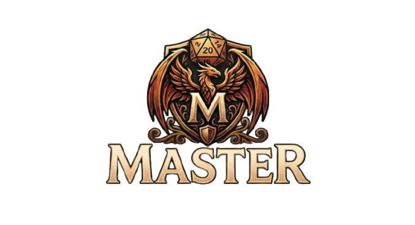

<p align="center">
  
</p>

<h1 align="center">T20 Master</h1>

<p align="center">
  Plataforma web para mestres de <strong>Tormenta 20</strong> gerenciarem campanhas, fichas e combates —
  com uma IA consultora de regras que consulta o livro básico via RAG.
</p>

<p align="center">
  <strong>Status:</strong> pausado — usado em uma sessão real com amigos.
</p>

---

## O que é

T20 Master centraliza o que um mestre de T20 precisa durante uma campanha: convidar jogadores, acompanhar
fichas de personagem, rodar combates táticos em tempo real num grid, e tirar dúvidas de regra com uma IA
que responde com base no PDF oficial do sistema (não "alucinando" regra).

Não há papéis globais — quem cria a campanha é o mestre dela (`Campaign.MasterId`); a mesma pessoa pode ser
jogadora em outra campanha. Convites são feitos por um link com código único por campanha.

## Funcionalidades

- **Campanhas** — criação, convite por link (`/campaign/{id}/join/{inviteCode}`), lista de jogadores.
- **Fichas de personagem** — atributos, classes, raças, perícias com bônus, magias, equipamentos e ouro,
  editáveis pelo jogador e visíveis ao mestre.
- **Mapa tático / combate** — grid de sessão com tokens (PCs, inimigos, NPCs, obstáculos), modificadores de
  combate e sincronização em tempo real entre todos os participantes via SignalR.
- **IA consultora de regras** — chat com streaming que responde perguntas sobre T20 usando RAG (busca
  vetorial sobre o PDF do livro básico) somado ao contexto das fichas da campanha.

## Stack

| Camada | Tecnologia |
|---|---|
| Runtime | .NET 10 — Blazor Server |
| Banco | PostgreSQL + pgvector (Docker, porta 5433) |
| ORM | Entity Framework Core |
| Auth | ASP.NET Core Identity (cookie auth) |
| Tempo real | SignalR |
| IA | Google Gemini API (REST direto), RAG com `gemini-embedding-001` |
| PDF | UglyToad.PdfPig (extração em 2 colunas) |
| Deploy | Docker na Railway |

## Arquitetura

```
┌───────────────────────────────────────────────┐
│                Railway (Docker)                │
│                                                 │
│   .NET 10 — Blazor Server                      │
│   ┌────────┐  ┌──────────┐  ┌───────────────┐  │
│   │  Auth  │  │ Campaign │  │  AI / RAG      │  │
│   │Identity│  │ Manager  │  │  (Gemini REST) │  │
│   └────┬───┘  └────┬─────┘  └──────┬────────┘  │
│        │           │               │           │
│        │     ┌─────┴─────┐  ┌──────┴──────┐    │
│        └─────┤  EF Core  │  │  SignalR Hub │    │
│               └─────┬─────┘  └─────────────┘    │
│                     │                           │
└─────────────────────┼───────────────────────────┘
                       │
              ┌────────┴────────┐
              │ PostgreSQL +    │
              │ pgvector        │
              └─────────────────┘
```

## Como rodar localmente

### Pré-requisitos

- [.NET 10 SDK](https://dotnet.microsoft.com/download)
- [Docker](https://www.docker.com/) (para o Postgres com pgvector)
- Uma chave de API do [Google AI Studio](https://aistudio.google.com/) (tier gratuito)

### Passo a passo

```bash
# 1. Subir o PostgreSQL (pgvector) na porta 5433
docker-compose up -d

# 2. Configurar segredos locais
cp src/T20Master.Web/appsettings.json src/T20Master.Web/appsettings.Development.json
# edite appsettings.Development.json com sua Gemini:ApiKey e o PdfPath do livro básico

# 3. Aplicar as migrations
dotnet ef database update --project src/T20Master.Web

# 4. Rodar o app
dotnet run --project src/T20Master.Web
```

> `appsettings.Development.json` é ignorado pelo git (`.gitignore`) — nunca commite chaves reais nele.

### Indexação do livro de regras (RAG)

Para o chat de IA funcionar, o PDF do livro básico precisa ser indexado uma vez:

```bash
dotnet run --project src/T20Master.Web -- --index-pdf       # indexa o PDF configurado em PdfPath
dotnet run --project src/T20Master.Web -- --retry-failed     # reprocessa chunks que falharam
dotnet run --project src/T20Master.Web -- --clear-chunks     # limpa todos os chunks indexados
```

## Configuração

Chaves esperadas em `appsettings.Development.json` (nunca commitadas):

| Chave | Descrição |
|---|---|
| `ConnectionStrings:DefaultConnection` | string de conexão do PostgreSQL |
| `Gemini:ApiKey` | chave da API Gemini (Google AI Studio) |
| `Gemini:ChatModel` | modelo usado no chat (ex: `gemini-2.5-flash-lite`) |
| `Gemini:EmbeddingModel` | modelo de embedding (`gemini-embedding-001`) |
| `PdfPath` | caminho absoluto para o PDF do livro básico de T20 |

Em produção (Railway), `ConnectionStrings__DefaultConnection` é substituída pela `DATABASE_URL` injetada
automaticamente pelo addon de Postgres.

## Estrutura do projeto

```
T20Master/
├── src/T20Master.Web/
│   ├── Program.cs                # DI, auth endpoints, comandos de CLI
│   ├── Components/
│   │   ├── Layout/                # MainLayout, NavMenu
│   │   └── Pages/
│   │       ├── Auth/               # Login, Register (SSR)
│   │       ├── Dashboard/
│   │       ├── Campaign/           # campanha, sessão, mapa tático, combate
│   │       ├── Character/          # fichas de personagem
│   │       └── AI/                 # chat com a IA de regras
│   ├── Hubs/                      # CampaignSessionHub (SignalR)
│   ├── Data/
│   │   ├── Entities/               # Campaign, CharacterSheet, GameSession, MapToken, RuleChunk...
│   │   └── T20Reference.cs         # listas estáticas de raças, classes, perícias
│   └── Services/
│       ├── CampaignService.cs / CharacterService.cs / CombatBoardService.cs / MapService.cs
│       └── AI/                     # PdfProcessor, EmbeddingService, RagIndexer, RagService, GeminiChatService
├── docker-compose.yml             # PostgreSQL + pgvector
└── Dockerfile                     # build multi-stage para deploy
```

## Decisões técnicas relevantes

- **Login/Register em SSR**: precisam setar cookies via resposta HTTP, por isso não usam
  `@rendermode InteractiveServer` — o restante das páginas autenticadas usa InteractiveServer.
- **Gemini via REST direto**: o SDK oficial teve incompatibilidades com a API atual; `EmbeddingService` e
  `GeminiChatService` chamam a API REST do Gemini diretamente via `HttpClient`.
- **Embeddings sem índice vetorial**: `gemini-embedding-001` gera vetores de 3072 dimensões, acima do limite
  do HNSW/IVFFlat do pgvector (2000). A busca é sequencial — suficiente para o volume de um único livro.

## Aviso

Tormenta 20 é propriedade da Jambô Editora. Este é um projeto pessoal de estudo, não oficial e sem vínculo
com a editora. O repositório não inclui conteúdo do livro: para usar o chat de regras, cada pessoa precisa
indexar o seu próprio exemplar, adquirido legalmente.
